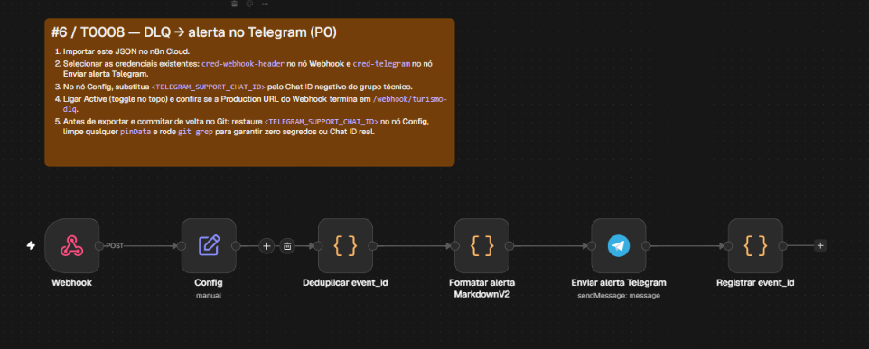
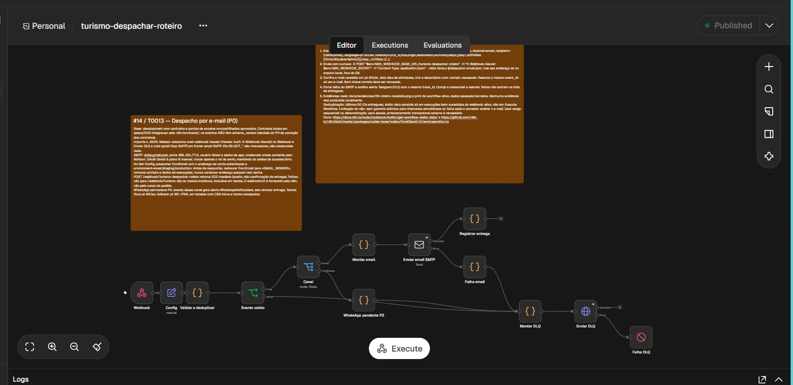
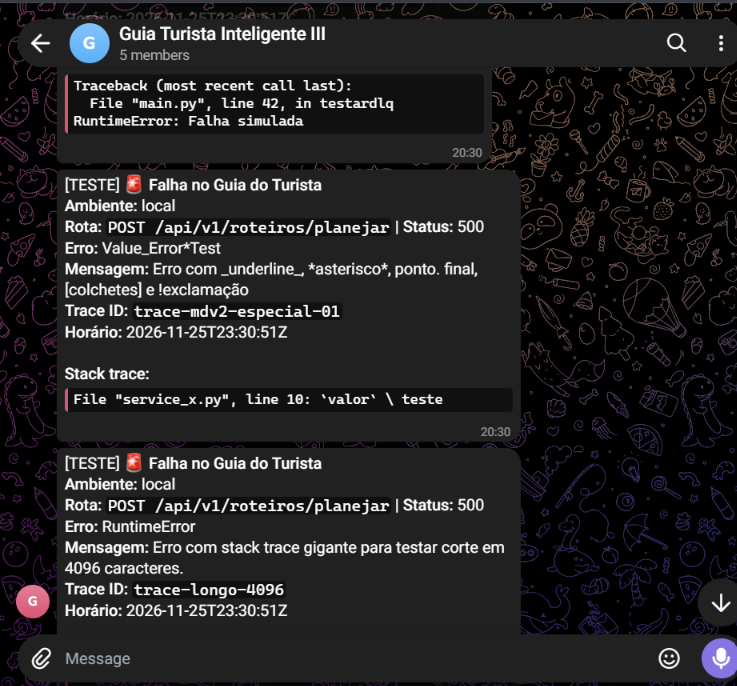
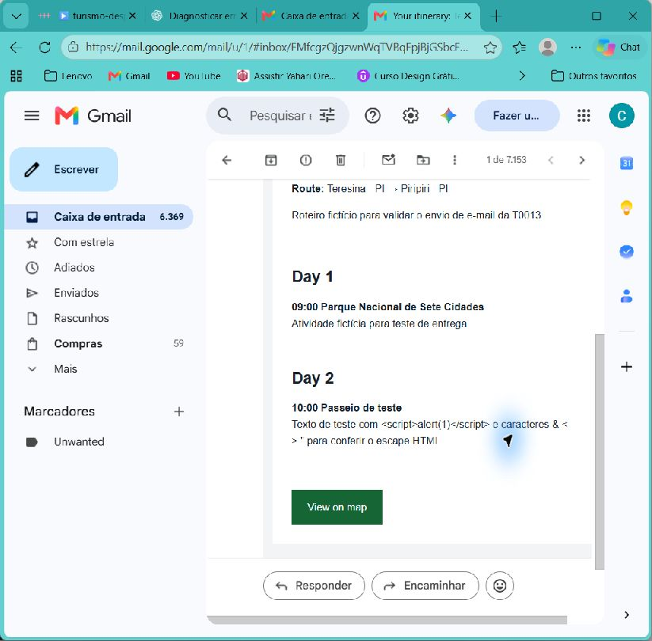

# Evidências — Spec 003: Integração EDA com n8n

> **Template e índice oficial da Spec 003 (`T0004` / Issue #22)**  
> Cada integrante edita **somente a sua seção**, conforme `specs/003-integracao-eda-n8n/MATRIZ.md` (§3 e §7).  
> Nenhum print ou log pode exibir credenciais, chaves de acesso, segredos de webhook, endereço de e-mail pessoal completo ou número de telefone completo.

---

## Arquitetura EDA (Backend → n8n → Telegram / E-mail)

1. O **backend FastAPI** processa as rotas de negócio (`/api/v1/chat`, `/api/v1/postos`, `/api/v1/despacho`, `/api/v1/suporte`) e agenda disparos HTTP assíncronos via `BackgroundTasks` (`publicar_evento`), liberando a resposta `202 Accepted` sem bloquear o cliente.
2. O publicador envia eventos JSON validados pelos contratos de `specs/003-integracao-eda-n8n/contracts/` para os webhooks do **n8n** autenticados com o cabeçalho `X-Webhook-Secret`.
3. No **n8n**, os workflows validam o payload, deduplicam `event_id` na janela dos últimos 50 eventos e orquestram a entrega final para os canais externos (**Telegram** e **e-mail SMTP**).
4. Qualquer exceção não tratada no backend (ou falha de entrega no despacho) gera um `DLQEvent` com `trace_id` único enviado ao webhook `/turismo-dlq`, que publica o alerta formatado em `MarkdownV2` no grupo técnico do **Telegram**.
5. Em direção reversa (**ChatOps**), comandos enviados ao bot do Telegram acionam o n8n, que consulta `/api/v1/suporte/*` com `X-Support-Key` (via túnel seguro) para inspecionar saúde, uptime, telemetria e testar a DLQ.

---

## Workflows do n8n (`docs/n8n/`)

| Workflow | Caminho do JSON | Dono | Status em `development` |
| --- | --- | --- | --- |
| **DLQ → Alerta no Telegram** | [`docs/n8n/turismo-dlq.json`](../n8n/turismo-dlq.json) | P2 — Mailson | ☑ Entregue (PR #26) |
| **ChatOps de Suporte no Telegram** | `docs/n8n/turismo-chatops.json` | P2 — Mailson | ☐ Pendente (PR #41 em revisão) |
| **Despacho de Roteiro por E-mail** | [`docs/n8n/turismo-despachar-roteiro.json`](../n8n/turismo-despachar-roteiro.json) | P5 — Cássio | ☑ Entregue (PR #25) |
| **Consulta de Clima (bônus)** | `docs/n8n/turismo-clima.json` | P5 — Cássio | ☐ Pendente / Opcional (Issue #16) |

---

## Índice de Evidências (`MATRIZ.md` §7)

| Nº | Título | Dono | Arquivo | Status |
| --- | --- | --- | --- | --- |
| **1a** | Workflows ativos no n8n — DLQ e ChatOps (P2) | P2 — Mailson | [`01a-workflows-p2-n8n.png`](01a-workflows-p2-n8n.png) | ☑ Entregue |
| **1b** | Workflows ativos no n8n — Despacho por e-mail (P5) | P5 — Cássio | [`01b-workflows-p5-n8n.png`](01b-workflows-p5-n8n.png) | ☑ Entregue |
| **2** | Alerta da DLQ recebido no grupo técnico do Telegram | P2 — Mailson | [`02-alerta-dlq-telegram.png`](02-alerta-dlq-telegram.png) | ☑ Entregue |
| **3** | ChatOps do bot de suporte no Telegram | P2 — Mailson | `03-chatops-telegram.png` | ☐ Pendente (PR #41) |
| **4** | Pop-up acessível de posto ANP no mapa da rota | P3 — Vitor | `04-popup-posto-anp.png` | ☐ Pendente (PR #34) |
| **5** | Chat multilíngue com IA (inglês + idioma de outro alfabeto) | P4 — Alisson | `05-chat-multilingue.png` | ☐ Pendente (Issue #13b) |
| **6** | Roteiro de viagem recebido por e-mail | P5 — Cássio | [`06-roteiro-recebido.png`](06-roteiro-recebido.png) · [`06-roteiro-recebido.md`](06-roteiro-recebido.md) | ☑ Entregue |
| **7** | Logs de execução assíncrona com `BackgroundTasks` | P1 — Mateus | `07-logs-backgroundtasks.log` | ☐ Pendente (Issue #20) |
| **8** *(extra)* | Resposta do workflow de clima (bônus) | P5 — Cássio | `08-clima-resposta.png` | ☐ Opcional (Issue #16) |

---

## Detalhamento por Evidência

### Evidência 1a — Workflows ativos no n8n (P2 · DLQ e ChatOps)

- **Dono:** Pessoa 2 — Mailson (`@MailsonSousa88`)
- **O que mostra:** Fluxo do workflow `turismo-dlq` (#6 / `T0008`) importado e configurado no n8n Cloud (`Webhook → Config → Deduplicar event_id → Formatar alerta MarkdownV2 → Enviar alerta Telegram → Registrar event_id`), sem credenciais ou segredos expostos. *(Nota: será atualizada no PR #41 para exibir também `turismo-chatops` lado a lado).*
- **Como reproduzir (comando ou passos):**
  1. Importar [`docs/n8n/turismo-dlq.json`](../n8n/turismo-dlq.json) no n8n Cloud.
  2. Associar as credenciais `cred-webhook-header` no nó `Webhook` e `cred-telegram` no nó `Enviar alerta Telegram`.
  3. Configurar `chatId` do grupo técnico no nó `Config` e ativar o workflow para disponibilizar `/webhook/turismo-dlq`.
- **Data/hora:** `2026-11-25T23:30:51Z` (PR #26).
- **Arquivo:** [`01a-workflows-p2-n8n.png`](01a-workflows-p2-n8n.png)
- **Observações:** Execução real no n8n Cloud com JSON versionado sanitizado (`<TELEGRAM_SUPPORT_CHAT_ID>` e `pinData: {}`).

---

### Evidência 1b — Workflows ativos no n8n (P5 · Despacho de roteiro)

- **Dono:** Pessoa 5 — Cássio (`@Cassiosampaio2016`)
- **O que mostra:** Captura completa do workflow `turismo-despachar-roteiro` (#14 / `T0013`) no n8n Cloud com indicador `Published` ativo, incluindo validação de contrato, deduplicação de `event_id`, envio SMTP e encaminhamento de falhas para `/webhook/turismo-dlq`, sem segredos visíveis.
- **Como reproduzir (comando ou passos):**
  1. Importar [`docs/n8n/turismo-despachar-roteiro.json`](../n8n/turismo-despachar-roteiro.json) no n8n Cloud.
  2. Selecionar `cred-webhook-header` nos nós `Webhook` e `Enviar DLQ`, e `cred-gmail` (SMTP `smtp.gmail.com:465` SSL/TLS) no nó `Enviar email SMTP`.
  3. Preencher `fromEmail` e `environment` no nó `Config` e publicar o workflow.
  4. Executar a suíte local dos nós Code: `node --test docs/n8n/turismo-despachar-roteiro.test.mjs`.
- **Data/hora:** `2026-11-25` (revisado e republicado em `2026-11-26T11:12-03:00`, PR #25).
- **Arquivo:** [`01b-workflows-p5-n8n.png`](01b-workflows-p5-n8n.png) (detalhes adicionais em [`06-roteiro-recebido.md`](06-roteiro-recebido.md)).
- **Observações:** Instância real publicada no n8n Cloud; exportação no repositório mantém `active: false` e marcadores de credenciais por segurança.

---

### Evidência 2 — Alerta da DLQ no Telegram

- **Dono:** Pessoa 2 — Mailson (`@MailsonSousa88`)
- **O que mostra:** Alertas reais entregues pelo bot no grupo técnico `Guia Turista Inteligente III` no Telegram, comprovando o prefixo `[TESTE] 🚨 Falha no Guia do Turista`, formatação `MarkdownV2` com escape de caracteres especiais (`_ * . [ ] ! \`) e truncamento seguro de `stack_trace` em 4096 caracteres.
- **Como reproduzir (comando ou passos):**
  1. Com o workflow `turismo-dlq` publicado no n8n Cloud, disparar um POST para `<N8N_WEBHOOK_BASE_URL>/turismo-dlq` com cabeçalho `X-Webhook-Secret` e payload seguindo [`specs/003-integracao-eda-n8n/contracts/dlq-event.schema.json`](../../specs/003-integracao-eda-n8n/contracts/dlq-event.schema.json) (ou acionar `POST /api/v1/suporte/testardlq` com `X-Support-Key`).
  2. Verificar resposta imediata `HTTP 202` e entrega da mensagem formatada no grupo do Telegram.
  3. Reenviar o mesmo `event_id` para confirmar descarte por deduplicação.
- **Data/hora:** `2026-11-25T23:30:51Z` (PR #26).
- **Arquivo:** [`02-alerta-dlq-telegram.png`](02-alerta-dlq-telegram.png)
- **Observações:** Testado contra a Production URL do n8n Cloud (`trace-mdv2-especial-01` e `trace-longo-4096`).

---

### Evidência 3 — ChatOps no Telegram

- **Dono:** Pessoa 2 — Mailson (`@MailsonSousa88`)
- **Status:** ☐ Pendente (aguardando merge do PR #41 — `feat/003-n8n-chatops`).
- **O que mostra:** *(a preencher pelo responsável na seção da Evidência 3 — interação com os comandos `/status`, `/uptime`, `/telemetria`, `/testardlq` e `/ajuda` no Telegram).*
- **Como reproduzir (comando ou passos):** *(a preencher pelo responsável).*
- **Data/hora:** *(a preencher pelo responsável).*
- **Arquivo:** `03-chatops-telegram.png` *(pendente em `development`)*.
- **Observações:** *(indicar `[LOCAL]` caso algum comando utilize stub/mock local).*

---

### Evidência 4 — Pop-up acessível de posto ANP no mapa

- **Dono:** Pessoa 3 — Vitor (`@vitorlopes-coder`)
- **Status:** ☐ Pendente (aguardando merge do PR #34 — `feat/003-popup-posto`).
- **O que mostra:** *(a preencher pelo responsável na seção da Evidência 4 — marcadores de postos da ANP ao longo da rota no mapa e pop-up acessível com dados da ANP).*
- **Como reproduzir (comando ou passos):** *(a preencher pelo responsável).*
- **Data/hora:** *(a preencher pelo responsável).*
- **Arquivo:** `04-popup-posto-anp.png` *(pendente em `development`)*.
- **Observações:** *(indicar `[LOCAL]` se gerado com `postos_fixture.json`)*.

---

### Evidência 5 — Chat multilíngue com IA (inglês + idioma de outro alfabeto)

- **Dono:** Pessoa 4 — Alisson (`@AlissonSena7`)
- **Status:** ☐ Pendente (será adicionada na Issue #13b — `feat/003-i18n`).
- **O que mostra:** *(a preencher na entrega da Issue #13b — diálogo no componente `ChatIA` em inglês e em idioma de outro alfabeto, ex.: árabe `ar` com direção `dir="rtl"`, hindi `hi`, russo `ru` ou mandarim `zh-CN`).*
- **Como reproduzir (comando ou passos):**
  1. Iniciar backend e frontend com `npm run dev` (ou `npx playwright test`).
  2. Abrir a aba **Chat IA**, selecionar/digitar em inglês (`en`) e em um segundo idioma de outro alfabeto (`ar`, `hi`, `ru` ou `zh-CN`).
  3. Confirmar resposta no mesmo idioma solicitado e prévia estruturada do roteiro.
- **Data/hora:** *(a preencher na captura da Issue #13b).*
- **Arquivo:** `05-chat-multilingue.png` *(pendente em `development`)*.
- **Observações:** *(indicar `[LOCAL]` caso a captura utilize o fallback stub sem `GEMINI_API_KEY`)*.

---

### Evidência 6 — Roteiro de viagem recebido por e-mail

- **Dono:** Pessoa 5 — Cássio (`@Cassiosampaio2016`)
- **O que mostra:** E-mail real recebido na caixa de entrada do Gmail com roteiro de dois dias (`Teresina PI - Piripiri PI`, `Day 1` e `Day 2`), botão `View on map` e validação de escape HTML (`` renderizado como texto puro), sem exibir endereço de e-mail pessoal completo.
- **Como reproduzir (comando ou passos):**
  1. Com o workflow `turismo-despachar-roteiro` publicado no n8n Cloud, enviar `POST <N8N_WEBHOOK_BASE_URL>/turismo-despachar-roteiro` com cabeçalho `X-Webhook-Secret` e payload conforme [`specs/003-integracao-eda-n8n/contracts/dispatch-event.schema.json`](../../specs/003-integracao-eda-n8n/contracts/dispatch-event.schema.json) (ou via `POST /api/v1/despacho/roteiro`).
  2. Confirmar retorno `HTTP 202`, entrega única na caixa de entrada e bloqueio de duplicidade ao repetir o mesmo `event_id`.
- **Data/hora:** `2026-11-25T16:13-03:00` (retestado em `2026-11-26T11:12-03:00`, PR #25).
- **Arquivo:** [`06-roteiro-recebido.png`](06-roteiro-recebido.png) e relatório técnico [`06-roteiro-recebido.md`](06-roteiro-recebido.md).
- **Observações:** Entrega real via Gmail SMTP no n8n Cloud (`event_id` `d0b75fdd-feb0-4583-bbb9-cdeb10272953` e reteste `84dfadb8-fe94-4353-ae77-032ba4a94f96`).

---

### Evidência 7 — Logs de execução assíncrona com `BackgroundTasks`

- **Dono:** Pessoa 1 — Mateus (`@MateusARJ`)
- **Status:** ☐ Pendente (aguardando execução do smoke test integrado — Issue #20 / `T0019`).
- **O que mostra:** *(a preencher pelo responsável na seção da Evidência 7 — logs do FastAPI comprovando o agendamento e disparo assíncrono de eventos via `BackgroundTasks` sem bloquear a requisição HTTP principal e com higienização de segredos).*
- **Como reproduzir (comando ou passos):** *(a preencher pelo responsável — execução de `scripts/smoke-003.ps1`).*
- **Data/hora:** *(a preencher pelo responsável).*
- **Arquivo:** `07-logs-backgroundtasks.log` *(pendente em `development`)*.
- **Observações:** *(a preencher pelo responsável).*

---

### Evidência 8 *(Extra / Opcional)* — Resposta do workflow de clima

- **Dono:** Pessoa 5 — Cássio (`@Cassiosampaio2016`)
- **Status:** ☐ Opcional / Bônus (Issue #16 / `T0020`, sujeito à regra de corte da `MATRIZ.md` §9).
- **O que mostra:** *(a preencher caso o workflow bônus `turismo-clima.json` seja incluído).*
- **Como reproduzir (comando ou passos):** *(a preencher pelo responsável).*
- **Data/hora:** *(a preencher pelo responsável).*
- **Arquivo:** `08-clima-resposta.png` *(opcional)*.
- **Observações:** Item bônus (`P3` na matriz de prioridades).
